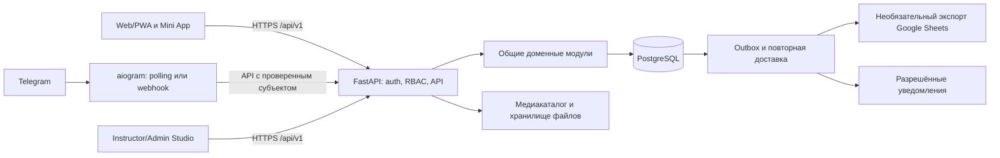

# B.E.S.T. Academy — проект архитектуры v2

Статус: предложение для утверждения D-01/D-02. Код платформы не реализовывался. Основной проект остаётся `VvikB/best-exam-bot`; `B.E.S.T.-Ski-test` сейчас используется для отчёта и проектных документов. Полное досье отсутствует. Все статусы решений — [реестр](BEST_DECISION_REGISTER_v2.md).

## Сравнение вариантов

| Вариант | Достоинства | Издержки | Решение |
|---|---|---|---|
| Продолжать только aiogram + JSON + Sheets | Минимум стартовых изменений | Нет независимого веб-входа, Studio, надёжных попыток и общей модели | Сохранить как legacy до перехода, не брать за целевую архитектуру |
| Django + серверные страницы/React | Готовые auth/admin, зрелый ORM | Отклонение от предпочтённого API-стека, часть Studio всё равно специальная | Резервный вариант при приоритете готовой админки; не выбран |
| FastAPI + React, модульный монолит | Соответствует ТЗ, общие правила и данные, независимые адаптеры | Auth, Studio и редактор надо спроектировать; больше начальной работы | Предлагается |
| Отдельные микросервисы обучения/экзаменов/контента | Независимое масштабирование | Распределённые транзакции и лишняя эксплуатация | Не требуется при текущем масштабе |

## Стек

React + TypeScript + Vite; React Router; TanStack Query для серверного состояния; локальный state для временного UI. SVG и CSS для первых интерактивов; Canvas/WebGL только после отдельного доказательства необходимости. Шрифты с кириллицей и подтверждённой лицензией поставляются локально. PWA через service worker с явными правилами кэша.

Python + FastAPI + Pydantic для контрактов; SQLAlchemy 2 и Alembic для транзакций/миграций. Предлагается стандартный синхронный ORM с обработчиками в thread pool для операций БД; запрещено вызывать блокирующий ORM/Google SDK внутри event loop. Асинхронный драйвер допустим после измерений, не обязателен для пилота. HTTP-клиент бота — асинхронный. PostgreSQL — интеграционные тесты, пилот и целевая эксплуатация при наличии подтверждённого бесплатного предложения. SQLite — быстрые локальные разработки и отдельные тесты; он не подтверждает совместимость PostgreSQL.

aiogram 3 — Telegram-адаптер к REST API. Он не начисляет баллы и не пишет экзаменационные таблицы напрямую. Redis, Celery и платные сервисы не обязательны в стартовой архитектуре. Версии зависимостей закрепляются и проверяются на совместимость перед реализацией: текущая `aiogram==3.10.0` — характеристика legacy, не обещание оставить её навсегда.

## Компоненты и границы доверия



Это один продукт с общим доменом, а не набор микросервисов. Web и Studio — маршруты одного frontend с серверной проверкой прав. API обслуживает оба представления и Mini App. При polling бот — отдельный процесс; в бесплатном webhook-варианте адаптер может быть смонтирован в том же HTTP-приложении. Выбор процесса и способ доставки определяет D-10 после проверки хостинга.

Модули: identity/access, learners/guardians, courses/content, learning/progress, assessments, practice, credentials, media, notifications/export, audit. Доменные правила не импортируют aiogram, FastAPI Request или конкретный Google-клиент. Адаптеры преобразуют вход в команды. БД и файловое хранилище — источники долгоживущего состояния, FSM бота — только состояние интерфейса.

## Предлагаемая структура основного репозитория

```text
best-exam-bot/
  bot.py, best_data.json, Procfile  # сохраняются на первом переходном этапе
  apps/
    api/                          # FastAPI, контракты, auth, webhook adapter
    telegram/                     # aiogram routers, навигация, API client
    web/                          # React: Academy + Studio + Mini App
  packages/
    domain/                       # правила без зависимости от транспорта
    application/                  # команды, запросы, транзакционные сценарии
    infrastructure/               # ORM, repositories, outbox, media, export
  migrations/
  content/                        # только проверенные manifests/источники без access codes
  scripts/                        # безопасный импорт и сверка, backup/restore
  tests/{unit,integration,telegram,e2e,content}/
  docs/{architecture,decisions,operations}/
```

Перенос legacy-файлов или переключение Procfile не выполняются автоматически. Файл ключа Google не переносится в новую структуру. Оригинальный банк сохраняется для контролируемого сравнения, но исходный JSON целиком не копируется в новый публичный контент: в нём есть коды доступа. Подробности — [миграция](BEST_MIGRATION_PLAN_v2.md).

## API и транзакции

Предлагаемые группы `/api/v1`: auth, me/profiles, courses/lessons, progress, assignments, training, exams/attempts, practice, certificates/verify, studio/content, studio/groups, media. Контракты описываются OpenAPI; ошибки имеют стабильный код, безопасное сообщение и correlation ID. ID субъекта и роль не принимаются от клиента как доказательство полномочий.

Примеры: `POST /exam-attempts` создаёт попытку по опубликованной версии; `PUT /exam-attempts/{id}/answers/{item_id}` сохраняет ответ с ожидаемой ревизией; `POST /exam-attempts/{id}/submit` завершает транзакционно; `GET /exam-attempts/{id}` восстанавливает разрешённое представление. Клиент не присылает итоговый score/level как авторитетное значение.

Ключ идемпотентности задаётся для создания попытки/submit/выдачи; конфликтующий повтор с другим телом возвращает конфликт, а не новый результат. При изменении попытки блокируется её строка либо используется revision с проверкой; завершённая попытка недоступна для изменения ответов. БД обеспечивает ограничения уникальности. Интеграции получают событие через outbox, созданный в той же транзакции, что и итог. Повтор доставки не создаёт вторую выдачу.

## Вход и безопасность — проект D-03/D-04

Для закрытого взрослого пилота предлагаются персональные приглашения и обычный независимый веб-вход: логин + пароль с Argon2id, серверные сессии, HttpOnly/Secure/SameSite cookie, CSRF-защита изменяющих запросов. Общие коды роли и постоянные URL-токены не используются. Без подтверждённого почтового сервиса восстановление через администратора с проверкой личности, одноразовой ссылкой с ограниченным сроком и журналом; процедуру надо утвердить. Публичная регистрация и passkeys — последующее решение, не обязательная платная зависимость пилота.

Mini App передаёт исходное initData, сервер проверяет подпись по официальному Telegram-алгоритму, возраст auth_date, приложение и политику повторного обмена. initDataUnsafe не доказывает личность. Telegram identity привязывается к существующему аккаунту только после подтверждения владения обоими; username не идентификатор для связывания. Веб-пользователь не обязан иметь Telegram.

Web cookie и Mini App проверяются в реальных клиентах; если WebView ограничивает cookies, допускается отдельный короткоживущий session token только в памяти с серверным отзывом. Нельзя хранить бессрочный bearer в localStorage или подкладывать bot token в frontend. Bot-to-API использует отдельную сервисную аутентификацию с ограниченными правами, проверенным Telegram actor и закрытым endpoint; он не имеет права произвольно назначать роль.

Авторизация: deny by default; роль + ресурс + назначение ученика + сроки полномочий. Разделение test/production, ограничение входов, журналы без initData/паролей/ключей, аудит изменений допусков, резервное копирование и учебный restore. Данные детей и публичность определяются отдельной политикой; до её приёмки пилот взрослый.

## PWA и фоновые процессы

В пилоте офлайн-кэшируются оболочка и явно разрешённые неперсональные опубликованные материалы. Ответы экзамена, ключи, персональные API-ответы, Studio и сертификаты не попадают в общий service-worker cache. Выход очищает связанные пользовательские локальные данные. Учебный прогресс отправляется серверу; при отсутствии сети отображается «не сохранено», а не ложное подтверждение. Офлайн-экзамен в пилот не включён.

Outbox-обработчик в минимальной установке может запускаться в составе одного приложения/допустимого worker с блокировкой задания, backoff, сроком lease и журналом ошибки. После пробуждения он продолжает по БД. Задания не должны храниться только в asyncio task. Сертификаты создаются после сохранения итогов; неуспех отправки не стирает попытку.

## Размещение и эксплуатация

Для пилота предпочтителен один origin для статики и API, управляемая PostgreSQL с проверенными квотами и резервированием, небольшие разрешённые медиа отдельно или на надёжном диске. Выбор provider остаётся открытым: текущие бесплатные условия PythonAnywhere/Netrun не подтверждены. Сон процесса, срок хранения диска, холодный старт и маршрутизация proxy проверяются экспериментом. Не рассчитывать на Docker, Redis или постоянно работающий worker, если тариф их не предоставляет.

Операционные проверки: readiness БД/версии миграции, отдельная liveness, метрики ошибок сохранения и outbox без персональных значений, backup + restore, завершение транзакций при SIGTERM, восстановление после рестарта. Публикация frontend не равна сохранности пользовательских данных.

Модель сущностей — [данные](BEST_DATA_MODEL_v2.md), неизменность публикаций — [контент](BEST_CONTENT_MODEL_v2.md), границы экзамена — [экзамен](BEST_EXAM_REDESIGN_v2.md).
