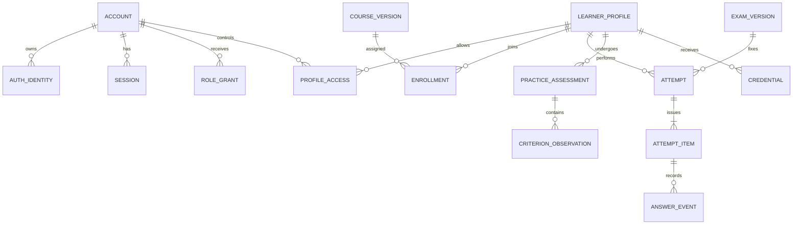

# B.E.S.T. Academy — проект схемы данных v2

Статус: логическая модель, не выполненные миграции. PostgreSQL — целевая БД; SQLite — локальный вариант с отдельными PostgreSQL-тестами. Решения D-02/D-04/D-11/D-12. [Архитектура](BEST_ARCHITECTURE_v2.md), [экзамен](BEST_EXAM_REDESIGN_v2.md).

## Основные отношения

## Identity, доступ и назначения

| Таблицы | Ключевые поля и ограничения |
|---|---|
| account | UUID, state, created_at; самостоятельная учётная запись, не Telegram ID |
| auth_identity | account_id, provider, provider_subject, credential reference; unique(provider, provider_subject); Telegram username не ключ |
| session | hashed opaque session ID, account_id, expires_at, revoked_at, auth_method; никогда открытый пароль |
| role_grant | account_id, role, scope_type/id, valid_from/to, granted_by, revoked_at |
| learner_profile | UUID, display_name, locale, age_band, status; точная дата рождения не собирается без обоснования |
| profile_access | account_id, profile_id, relation, permissions, подтверждение/срок; связь родителя проверяется |
| consent_record | profile_id, actor_id, policy_version, purpose, action, timestamp, evidence reference; процесс D-04 |
| teaching_group / group_membership | группа, профиль, сроки участия, источник назначения |
| instructor_assignment | instructor_account_id, group/profile, scope, сроки и отзыв; объектные права |
| enrollment / assignment | profile_id, course/lesson/practice_version_id, assigned_by, due_at, status |

У ребёнка может быть профиль под управлением представителя; наличие профиля не означает наличие собственного независимого аккаунта. Взрослый контролирует свой профиль. Ограничения доступа проверяются по разрешённым связям; клиентский profile_id сам по себе ничего не доказывает. Администраторский доступ не отменяет аудит и минимизацию данных.

## Контент

`content_entity(id,type,stable_key)` → `content_version(id,entity_id,version,status,parent_version_id,source_revision,created_by,created_at,published_at)`; unique(entity_id,version). Подтаблицы lesson_version, course_version, module_version, activity_version и question_version содержат типизированный payload по схеме и ссылкам.

`content_translation(version_id,locale,payload,status,review_id)`; unique(version_id,locale). `source_reference(id,origin,revision,locator,checksum)` и `content_source_link` фиксируют происхождение. `review_decision(version_id,review_kind,reviewer_id,decision,reason,created_at)` — неизменяемое событие. Публикационные права отдельно от авторства.

`course_item(course_version_id,position,module/lesson_version_id)`; prerequisites образуют проверяемый ациклический граф. `competency` и `content_competency` связывают B/E/S/T и конкретные наблюдаемые критерии. `media_asset`, `media_version`, `license_evidence`, `content_media_link` хранят метаданные из [модели контента](BEST_CONTENT_MODEL_v2.md); бинарные файлы — в разрешённом хранилище, не в поле JSON БД.

## Обучение

`learning_session`, `lesson_progress(profile_id,lesson_version_id,checkpoint,revision,started_at,updated_at,completed_at)`, `learning_event`, `activity_response`. Unique(profile_id,lesson_version_id) для агрегированного прогресса; события сохраняют историю. Прочитанный материал, ответ в тренажёре, наблюдение инструктора и аттестация — разные измерения. `recommendation` содержит правило/основание и не маскируется под доказанный персональный диагноз.

Инструкторские заметки имеют автора, профиль, scope/видимость, историю правок и срок хранения. Не добавлять произвольные медицинские данные в общий комментарий. Удаление и экспорт персональных данных должны учитывать правовые требования и основания хранения протоколов; бессрочное хранение не задаётся по умолчанию.

## Экзамены и практика

| Таблица | Назначение |
|---|---|
| exam_definition / exam_version | Тип проверки, аудитория, опубликованные item versions, blueprint, policy_version_id |
| exam_policy_version | Единицы шкалы, обязательность, время, пересдача, critical, практика, approved_by/at; без принятой policy экзамен не публикуется |
| case_version / case_item | Контекст кейса, порядок, допустимость перемешивания, связи |
| question_version / option_version | Стабильные UUID вариантов; правильность отдельно от ученического API |
| attempt | profile_id, exam_version_id, policy_version_id, locale, state, revision, started_at, deadline_at, submitted_at, max_score, score, percent, outcome, reason |
| attempt_item | attempt_id, position, question_version_id, case_version_id, required, weight, issued_option_order, issued_snapshot_hash |
| answer_event | attempt_item_id, sequence, response, actor, server_received_at, client_event_id; append-only история |
| accepted_answer | attempt_item_id unique, answer_event_id, revision; последнее допустимое состояние до submit |
| attempt_event | create/start/pause/resume/submit/expire/grade/invalidate с actor/reason; не смешивать транспортный дубль с новым действием |
| practice_rubric_version | Утверждённые критерии, условия, critical, evidence policy и полномочия экзаменатора |
| practice_assessment | profile_id, rubric_version_id, examiner_id, scope, date, status, result, reason |
| criterion_observation | assessment_id, criterion_id, observation, result, evidence reference, timestamp |

Модель итогового внутреннего статуса проверяет согласованные theory + practice + допуск + версию требований. Расчёт и переходы — [экзаменационная модель](BEST_EXAM_REDESIGN_v2.md). Ограничения FK, unique и транзакционные проверки предотвращают сиротские ответы и повторный submit. `score` как вычисленный итог сохраняется вместе с входной версией и сверяется повторным расчётом; ученический запрос не может записать его напрямую.

## Документы и интеграции

`credential(id,number,type,profile_id,requirements_version_id,status,issued_at,revoked_at,reason,supersedes_id,verification_token_hash)`, `credential_evidence` (attempt/practice), `credential_artifact` (template_version,file_hash,storage_key,locale). Unique(number); уникальное основание выдачи для предотвращения дубля. Отзыв не удаляет историю. Публичная проверка возвращает только утверждённый минимальный набор полей, не детский профиль.

`outbox_event(id,aggregate_id,event_type,payload,created_at,available_at,lease_until,attempts,status,last_error_code)`; `delivery_receipt(event_id,destination,external_id)` с уникальностью события/получателя. Sheets — проекция, не первичное хранилище результата. Логи не содержат необработанные credentials и initData.

`processed_integration_event(provider,app_id,event_id,payload_hash,status)` — unique(provider,app_id,event_id); изменение тела при том же ID вызывает тревогу/конфликт. `idempotency_record(actor,operation,key,request_hash,response_reference,expires_at)` предотвращает повторные попытки/выдачи. `audit_event` содержит субъект, действие, тип/ID объекта, причину, время и безопасный diff, но не пароль/токен.

## Время, версии и жизненный цикл

Все серверные времена — UTC с timezone; интерфейс отображает согласованный часовой пояс пользователя. Длительность считается по серверным событиям, deadline не зависит от часов телефона. Номер версии и UUID неизменяемой версии не заменяют друг друга.

Не применять CASCADE DELETE к журналу попыток и опубликованным версиям, от которых зависят результаты. Использовать ограничение удаления/архивацию и отдельный процесс персонального обезличивания. Опубликованные payload защищаются приложением и проверками доступа; для критических таблиц дополнительно рассматриваются DB-ограничения неизменности. Retention и состав backup утверждаются D-04/D-12.

## Миграции и backup

Alembic-миграции проходят на пустой PostgreSQL и на предыдущей поддерживаемой схеме с тестовыми данными. Приложение не стартует с несовместимой схемой. Изменения по expand/migrate/contract, без разрушения старых данных в первом деплое. Полный downgrade не обещается для необратимых операций; rollback проверяется восстановлением backup и совместимой версией приложения.

Для пилота предложение: ежедневная зашифрованная копия в отдельном контролируемом месте, копия до миграций, документированное восстановление и сверка записей/ссылок на медиа. Целевые RPO/RTO и срок хранения утверждаются после проверки бесплатной инфраструктуры; наличие команды backup без успешного restore не считается готовностью.
