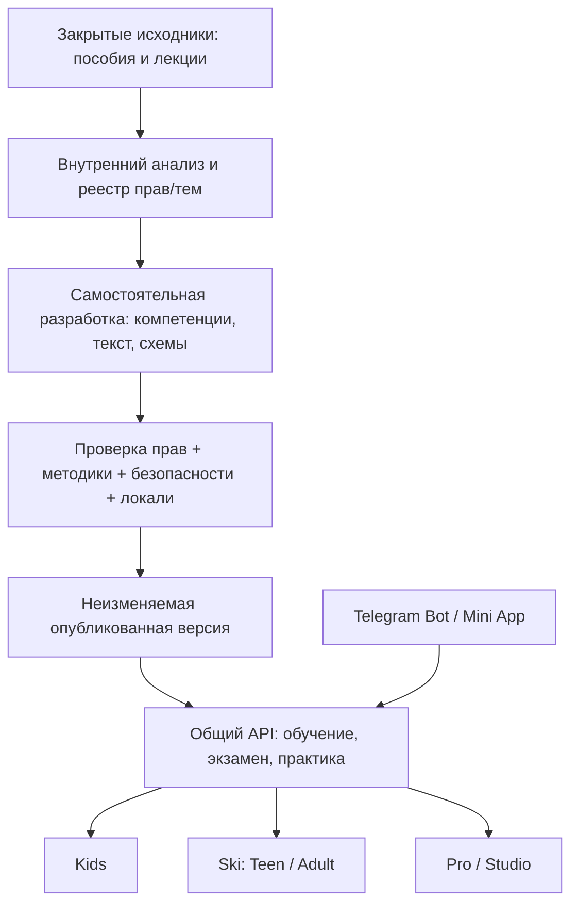

# B.E.S.T. Academy — архитектура продукта и правовых границ v3

Статус: предложение на утверждение, без реализации backend/frontend и рефакторинга бота. Продолжает v2; согласие на загрузку документов v2 не означало утверждения архитектуры. [UX](BEST_SPACES_UX_v3.md), [контент](BEST_INTERACTIVES_MEDIA_v3.md), [экзамен](BEST_EXAM_PRACTICE_v3.md).

## 1. Выбор архитектуры

Сохранить предложенный модульный монолит FastAPI + PostgreSQL + React/TypeScript/Vite. Telegram/aiogram — транспортный адаптер к общему домену, а Kids/Ski/Pro — пространства одного приложения с разными представлениями и полномочиями. Три бренда не требуют трёх БД, трёх независимых расчётов прогресса и отдельных сервисов.

| Вариант | Оценка |
|---|---|
| Наращивать только JSON/aiogram | Не покрывает независимый веб-вход, правовые gates и долговременные попытки |
| FastAPI + React, модульный монолит | Совпадает с ТЗ и предыдущим проектом; требует явной реализации auth/Studio/ревью |
| Django + React | Возможен ради готового auth/admin, но нет подтверждённой причины менять согласуемое направление |
| Микросервисы | Нет доказанного масштаба для распределённых транзакций/сложной эксплуатации |

Не вводить обязательные платные сервисы, WebGL/физический движок или AI-генерацию curriculum в критический путь. Canvas нужен только при доказанном ограничении SVG. SQLAlchemy/Alembic обеспечивают явные миграции; SQLite допустим локально, production-проверки идут на PostgreSQL.

## 2. Три зоны данных



**Restricted research:** исходные файлы и необходимая внутренняя разметка с ограниченным доступом. Не в GitHub/public media, не в frontend bundle, не в service worker и не в внешнюю систему обработки без отдельного разрешения. Source rights registry не делает все исходные документы общедоступными.

**Authoring/staging:** собственные draft-тексты, briefs и рубрики, source/claim references, review и права на создаваемые assets. Возможные заимствования блокируются до доказанного разрешения; нельзя очистить права простым переименованием.

**Published learning:** только принятые версии оригинального/разрешённого контента. API выдаёт учащемуся допустимую опубликованную версию, не оригинальный защищённый PDF и не внутренние заметки reviewer. Архивация/отзыв не переписывают прошлые попытки.

## 3. Модули и сущности

- Identity/access: account, auth identity, session, role grant, profile access, guardian relation/consent, scope/срок полномочий.
- Research/rights: source, file/member, duplicate group, source claim, topic link, rights evidence, permitted use, reviewer decision. Закрытые файлы и секреты не записываются в публичные поля.
- Content/media: competency, program/course/module/lesson versions, translations, asset/media versions, license evidence, activities, publications и withdrawals.
- Learning: enrollment, assignment, checkpoint, activity response, reflection; KNOW/LAB/OBS/ASSESS разделены.
- Assessment: question/case/exam/policy versions, attempt snapshot, issued order, answer events, result и retake eligibility.
- Practice/credentials: examiner scope, rubric version, observations, protocol, internal status, document evidence, number/verify/revoke.
- Operations: audit log, idempotency records, processed update IDs, outbox, delivery receipts, backup/restore metadata.

Каждый объект имеет stable ID; версия — отдельный immutable ID. Source provenance связан с конкретной версией/страницей/таймкодом, а не одним неинформативным «по материалам школы». Для архивного member фиксируется parent archive и hash. Опубликованный payload не меняется от правки черновика.

## 4. Доменные и API-границы

REST `/api/v1`: auth/profiles, academy/programs, lessons/activities, learning/progress, assignments, assessment/attempts, practice, credentials/verify, studio/content/media/reviews и отдельные restricted research endpoints. Frontend не начисляет окончательный балл и не назначает пользователю роль. Сервисный Telegram-адаптер не имеет неограниченного права impersonation.

Команды сохраняют транзакционный результат и outbox вместе. `submit_attempt` блокирует конкурентное изменение, проверяет owner/допуск/версию/полноту/срок/critical и идемпотентность. Sheets и Telegram-доставка — повторяемые внешние операции после commit, а не единственное место существования результата.

Пример самостоятельной архитектуры репозитория после утверждения:

```text
best-exam-bot/
  bot.py, best_data.json              # legacy до контролируемого перехода
  apps/api, apps/telegram, apps/web   # новые адаптеры; Kids/Ski/Pro в web
  packages/domain, application, infrastructure
  migrations/
  content/approved_manifests/         # без закрытых первоисточников и access codes
  tests/unit,integration,telegram,e2e,content
  docs/decisions,operations
```

Restricted research хранится за пределами публикуемого checkout и пакета продукта. Реальная схема каталогов/миграции утверждается до реализации. Этот проектный комплект создан вне обоих репозиториев.

## 5. Вход, несовершеннолетние и права

Персональный независимый веб-вход; для закрытого взрослого пилота — приглашения, Argon2id, серверные сессии HttpOnly/Secure/SameSite и CSRF. Без подтверждённой бесплатной почты recovery имеет согласованную административную процедуру, срок и журнал; нет общих паролей роли. Telegram identity привязывается с подтверждением владения обоими аккаунтами, не по username.

Mini App: сервер проверяет initData и auth_date по официальному алгоритму, не доверяет initDataUnsafe. Проверить cookie/session в реальных клиентах; при необходимости отдельный короткоживущий token только в памяти с отзывом. Bot token никогда не уходит в браузер.

Роли + объект + актуальное назначение + возрастная политика. Чтение Pro-курса не даёт roster доступа. Представитель не присоединяет ребёнка по одному найденному Telegram ID. Не собирать точную дату рождения, медицинскую историю или видео ребёнка без подтверждённой необходимости/процедуры. Предлагаемый первый пилот взрослый; Kids/Teen публикуются после отдельной приёмки privacy/guardian policy, а не считаются отменёнными.

## 6. Размещение, offline и безопасность

Один HTTPS origin для статики/API предпочтителен. PWA кэширует только оболочку и разрешённые неперсональные материалы. Персональные ответы/источники/экзаменационные ключи не попадают в общий cache; при выходе очищается пользовательский локальный state. Offline-экзамен пока не предлагается. Клиент показывает неподтверждённое сохранение честно.

Нулевые обязательные расходы на хостинг остаются требованием. Конкретные бесплатные условия PythonAnywhere/Netrun и PostgreSQL/хранилища не проверены. До выбора проверить TLS, исходящие запросы через штатный proxy, холодный старт после простоя, срок хранения БД/диска и restore. Sleeping HTTP-сервис не означает работающий polling; webhook подходит только при подтверждённом приёме HTTPS и пробуждении. 24/7 не обещается.

Google key из legacy остаётся P0 до подтверждённого отзыва владельцем; никаких копий в новом архиве. После согласования очистить дерево/историю и заменить секретные конфигурации безопасными. Производственные токены/таблицы не используются как тестовые по умолчанию.

## 7. Что нужно утвердить

Модульный монолит и репозиторий, границы трёх пространств/возраста, пилот, правила independent auth/guardian, подтверждённые права/источники, методические критерии, exam policy/практика/документы и бесплатная инфраструктура с backup. Согласование каталога тем не означает одобрение каждой инструкции. [Реестр решений](BEST_REVIEW_DECISIONS_v3.md).
